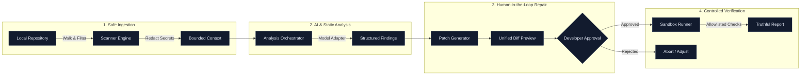

# RepoGuard

> **Fix with evidence. Verify before trust.**
> A CLI-first software reliability assistant that inspects repositories safely, discovers vulnerabilities with deterministic code evidence, proposes reviewable patches, and verifies fixes inside controlled sandboxes.

[](https://unstop.com/hackathons/codenexus-india-2026-national-hackathon-wecodecoders-1764747)
[](https://unstop.com/hackathons/codenexus-india-2026-national-hackathon-wecodecoders-1764747)
[]()
[](https://www.typescriptlang.org/)
[](https://nodejs.org/)
[](#architecture--directory-structure)
[](https://vitest.dev/)
[](#security--safety-guardrails)
[](LICENSE)

---

**Project Context:** Built for the **CodeNexus India 2026 National Hackathon (WeCodeCoders)** on [Unstop](https://unstop.com/hackathons/codenexus-india-2026-national-hackathon-wecodecoders-1764747).
**Team:** Pratham, Team Lead, Ayan, Manni.

---

## Problem & Approach

### The Problem
Most AI coding assistants propose plausible-looking code suggestions without any empirical proof that the patch actually works:
1. **Unverified Patches Break Code:** Large language models routinely hallucinate fixes that pass casual visual review but fail edge cases or introduce regression bugs.
2. **Untrusted Command Execution:** Directly auto-executing model-generated commands on developer machines creates severe security risks (accidental deletions, untrusted network access, credential exposure).
3. **Fragmented Evidence:** Developers are forced to manually correlate compiler outputs, test logs, AI suggestions, and git diffs across multiple tools.

### The RepoGuard Approach
RepoGuard turns code analysis, patch synthesis, and sandboxed test execution into a continuous, verifiable workflow directly in the terminal:
- **Discovers** codebase structure using safe, read-only file traversal while filtering out secrets and binary files.
- **Investigates** bugs, security vulnerabilities, and performance bottlenecks backed by concrete line-level evidence.
- **Synthesizes** targeted unified diff patches without modifying the working tree.
- **Requires** explicit developer approval at an interactive confirmation gate before touching disk.
- **Verifies** candidate patches in an isolated execution sandbox using allowlisted checks with bounded timeouts.
- **Reports** truthful, empirical outcomes (`PASSED`, `FAILED`, `TIMED_OUT`) with zero fabricated assurances.

---

## Architecture Pipeline



---

## Quickstart & Evaluation Walkthrough

For hackathon evaluators testing the CLI workflow:

```bash
# 1. Run safe repository scan and inventory supported files
npx repoguard scan

# 2. Inspect high-signal findings backed by verified line-level code evidence
npx repoguard review

# 3. Generate a targeted unified diff patch tied to a specific finding
npx repoguard fix FINDING-001

# 4. Execute allowlisted checks inside a temporary verification sandbox
npx repoguard test REPAIR-001

# 5. Output a structured, evidence-backed audit report
npx repoguard status SCAN-001
```

---

## 15 Core Capabilities & Roadmap

The architecture is designed around 15 capabilities, prioritizing a dependable local CLI vertical slice for the hackathon before scaling to cross-repository intelligence:

| # | Capability | Phase | Description |
| :-: | :--- | :---: | :--- |
| **01** | **Repository / GitHub Ingestion** | `MVP` | Safe, read-only scanning of local codebases; respects `.gitignore`, skips oversized (>1MB) and binary files. |
| **02** | **Multi-Pass Investigation** | `MVP` | Static AST rules and AI agents analyzing bugs, OWASP security vulnerabilities, and performance bottlenecks. |
| **03** | **RAG & Persistent Memory** | `Next` | Bounded retrieval of historical fixes, architectural conventions, and relevant context snippets without prompt bloating. |
| **04** | **AI Repair Engineer** | `MVP` | Synthesizes precise unified diff patches bound to a specific finding, with changed-path lists and human-readable rationales. |
| **05** | **Sandbox Verification** | `MVP` | Executes allowlisted verification checks (`test`, `lint`, `typecheck`) in disposable workspaces with strict timeouts (Subprocess & Docker). |
| **06** | **Learn from Fix Outcomes** | `Next` | Records verified fixes and failed attempts, creating an empirical dataset of what works and what breaks. |
| **07** | **Authorized GitHub Pull Requests** | `Next` | Publishes tested, human-approved patches to GitHub pull requests using least-privilege GitHub Apps. |
| **08** | **Root-Cause Timeline** | `Next` | Chronologically links scan runs, findings, candidate diffs, verification logs, and commits into an audit trail. |
| **09** | **Regression & Side-Effect Prediction** | `Later` | Evaluates downstream dependency impact and recommends targeted regression test suites for candidate patches. |
| **10** | **Repository Knowledge Graph** | `Later` | AST-level symbol dependency graph mapping imports, calls, and module boundaries to quantify blast radius. |
| **11** | **Evidence-Based Repair Confidence** | `MVP` | Computes explainable confidence metrics from evidence coverage, AST alignment, and test outcomes—not model self-assessment. |
| **12** | **Human Approval Gate** | `Safety` | Non-negotiable confirmation gate. No file is ever modified on disk without explicit developer interactive approval. |
| **13** | **Future Bug Predictor** | `Later` | Statistical hotspot analysis correlating code churn, complexity, and historical defect density. |
| **14** | **Telemetry-Driven Rollback** | `Later` | Correlates operational alerts with recent releases to recommend automated, safe revert PRs. |
| **15** | **Cross-Repo Ripple Immunization** | `Vision` | Identifies vulnerability patterns resolved in Repo A and proactively recommends immunization patches in authorized connected Repos B & C. |

> [!NOTE]
> Capabilities marked `MVP` belong to the active development milestone. Advanced modules (`memory/`, `github/`, `background-jobs/`, `telemetry/`) are staged under [`src/advanced/`](src/advanced/).

---

## Team & Module Ownership

The project enforces strict modular monolith boundaries to ensure clean parallel development:

| Team Member | Role | Owned Modules | Core Responsibilities |
| :--- | :--- | :--- | :--- |
| **Team Lead** | CLI, Application, Domain & AI Analysis | `src/cli/`<br>`src/application/`<br>`src/domain/`<br>`src/analysis/`<br>`src/providers/`<br>`src/utils/` | CLI routing & terminal options (`commander`), shared domain contracts (`Zod`), use-case orchestration, Google Gemini model adapter, static rule runner, and system integration. |
| **Pratham** | Repair & Sandbox Verification | `src/repair/`<br>`src/verification/`<br>`src/domain/repair/`<br>`src/domain/verification/` | Unified diff generation & parsing, path traversal security, interactive developer approval gate, allowlisted check runner with timeouts, and Docker sandbox adapter. |
| **Ayan** | Configuration, Storage & Reporting | `src/config/`<br>`src/storage/`<br>`src/report/`<br>`examples/`<br>`.repoguard/` | Configuration schema & loading (`repoguard.config.json`), local state & run persistence (`.repoguard/state`), Markdown & JSON audit report builders. *(Note: CLI is owned by Team Lead).* |
| **Manni** | Repository Scanning & Context Intelligence | `src/repository/`<br>`src/context/`<br>`src/domain/repository/` | Repository root detection, safe file traversal (`.gitignore`, binary skips, >1MB limit), Git state reader, bounded context builder, and regex/entropy secret redaction. |

---

## Security & Safety Guardrails

RepoGuard treats target codebases as untrusted input:

1. **Zero Secret Leakage:** High-entropy tokens, passwords, private keys (`.pem`, `.key`), and `.env` files are automatically redacted into `[REDACTED_SECRET]` before any payload reaches an AI model provider.
2. **Path Traversal Guards:** All patch file targets are sanitized with [`src/utils/safe-path.ts`](src/utils/safe-path.ts). Relative path escapes (`../../etc/passwd`) and absolute target locations outside the project boundary are strictly blocked.
3. **Mandatory Approval Gate:** No proposed patch is ever applied automatically. Modifying disk requires explicit, interactive developer confirmation.
4. **Controlled Subprocess Execution:** AI models are never allowed to execute arbitrary shell commands. Verification commands are checked against a strict, predefined allowlist (e.g. `npm test`, `npm run lint`) and executed within bounded timeouts.
5. **Read-Only Scans:** The scan and review phases make zero modifications to the target repository.

---

## Architecture & Directory Structure

```
repoguard/
├── src/
│   ├── index.ts                           # Executable Composition Root (Team Lead)
│   ├── cli/                               # CLI Routing, Options & Terminal Formatter (Team Lead)
│   │   ├── commands/                      # init, scan, review, fix, test, status, config
│   │   ├── formatter.ts                   # Unified terminal styling, tables, and progress spinners
│   │   └── options.ts                     # Command argument parsing & help formatting
│   ├── application/                       # Use Case Orchestration & Ports (Team Lead)
│   │   ├── use-cases/                     # ScanRepository, ReviewFindings, ProposeRepair, VerifyRepair
│   │   └── ports/                         # Scanner, AIProvider, PatchWriter, TestRunner interfaces
│   ├── domain/                            # Pure Domain Entities & Contracts (Shared / Team Lead)
│   │   ├── finding.ts                     # Finding entity, severity, status, evidence
│   │   ├── repair.ts                      # Repair proposal & unified diff models (Pratham)
│   │   ├── verification.ts                # Verification outcome classification (Pratham)
│   │   ├── repository.ts                  # Source file & repo metadata entities (Manni)
│   │   └── shared.ts                      # Result<T, E>, DomainError, Branded IDs
│   ├── repository/                        # Safe Repository Discovery & Traversal (Manni)
│   │   ├── discovery.ts                   # Root detection, language & build tools
│   │   ├── file-walker.ts                 # Safe walk respecting .gitignore & file size limits
│   │   ├── git-reader.ts                  # Git status, commit SHA & diff reader
│   │   └── metadata.ts                    # Manifest & lockfile parser
│   ├── context/                           # Context Assembly & Secret Redaction (Manni)
│   │   ├── context-builder.ts             # Token budgeting & relevance ranking
│   │   └── secret-redactor.ts             # Regex + entropy credential scrubber
│   ├── analysis/                          # Static & AI Analysis Engine (Team Lead)
│   │   ├── orchestrator.ts                # Request validation & normalizer
│   │   ├── agents/                        # Bug, security, and performance investigation agents
│   │   └── rules/                         # Deterministic static rule definitions & runner
│   ├── providers/                         # AI Model Provider Adapters (Team Lead)
│   │   ├── provider.contract.ts           # Unified provider interface & error taxonomy
│   │   ├── schemas.ts                     # Zod schemas for structured completion outputs
│   │   ├── gemini-adapter.ts              # Google Gemini API integration
│   │   └── mock-adapter.ts                # Deterministic test fixture adapter
│   ├── repair/                            # Safe Patch Proposal & Validation (Pratham)
│   │   ├── repair-orchestrator.ts         # Proposal coordination
│   │   ├── patch-parser.ts                # Unified diff parser & path traversal guard
│   │   ├── approval-gate.ts               # Interactive affirmative confirmation prompt
│   │   └── patch-applicator.ts            # Controlled diff application
│   ├── verification/                      # Controlled Process & Sandbox Runner (Pratham)
│   │   ├── verification-orchestrator.ts   # Check runner coordination
│   │   ├── check-runner.ts                # Subprocess runner with command allowlists & timeouts
│   │   ├── result-classifier.ts           # Truthful outcome taxonomy (PASSED/FAILED/TIMED_OUT)
│   │   └── sandbox/                       # Docker container sandbox runner & policy
│   ├── config/                            # Configuration Schema & Loading (Ayan)
│   │   ├── schema.ts                      # Zod schema for repoguard.config.json
│   │   └── loader.ts                      # Config loader with CLI & environment overrides
│   ├── storage/                           # Local Run & Finding Persistence (Ayan)
│   │   ├── state-store.ts                 # Local state manager (.repoguard/state)
│   │   └── run-store.ts                   # Scan run & finding records
│   ├── report/                            # Report Builders & Formatters (Ayan)
│   │   ├── report-builder.ts              # Markdown & JSON summary coordinator
│   │   └── markdown-report.ts             # Human-readable audit report generator
│   ├── utils/                             # Shared Core Utilities (Team Lead)
│   │   ├── logger.ts                      # Structured leveled logging
│   │   └── safe-path.ts                   # Path normalization & directory escape guards
│   └── advanced/                          # Staged Advanced Capabilities (Preserved)
│       ├── background-jobs/               # Redis & BullMQ asynchronous worker queues
│       ├── github/                        # Authorized GitHub App & PR publisher
│       ├── memory/                        # Cross-repo vector memory & immunization
│       └── telemetry/                     # Audit event stream & rollback policy
│
├── tests/
│   ├── unit/                              # Unit tests mapped 1:1 to module owners
│   ├── integration/                       # Scan pipeline, provider contract, repair verification
│   ├── security/                          # Secret redaction, path traversal, command blocking
│   ├── fixtures/                          # Clean, buggy, and vulnerable sample repos
│   └── helpers/                           # Mock providers, temporary repo factories, assertions
│
├── examples/                              # Annotated sample config, findings, and repair reports
└── .repoguard/                            # Runtime workspace cache and local state
```

---

## Getting Started

### Prerequisites
- **Node.js:** `>= 22.0.0` (see [`.nvmrc`](.nvmrc))
- **npm:** `>= 10.0.0`
- **Git:** `>= 2.40.0`

### Setup Commands
```bash
# 1. Clone repository
git clone https://github.com/Pratham707-S/repoguard.git
cd repoguard

# 2. Switch to Node 22 & install dependencies
nvm use 22
npm install

# 3. Setup local environment
cp .env.example .env

# 4. Run verification checks
npm run typecheck   # Typecheck TypeScript (strict mode)
npm run lint        # ESLint flat configuration
npm test            # Vitest suite
npm run build       # Build dist/ bundle
```

---

## Documentation Index

- 📖 **Interactive Master Guide:** [`docs/PROJECT_GUIDE.html`](docs/PROJECT_GUIDE.html)
- 📐 **Architecture Specification:** [`docs/ARCHITECTURE.md`](docs/ARCHITECTURE.md)
- 🗺️ **Roadmap & Milestones:** [`docs/ROADMAP.md`](docs/ROADMAP.md)
- 📋 **Team Tasks & Contracts:** [`docs/TEAM_TASKS.md`](docs/TEAM_TASKS.md)
- 🛡️ **Threat Model:** [`docs/THREAT_MODEL.md`](docs/THREAT_MODEL.md)
- ⚙️ **Configuration Reference:** [`docs/CONFIGURATION.md`](docs/CONFIGURATION.md)
- 💻 **CLI Reference:** [`docs/CLI_REFERENCE.md`](docs/CLI_REFERENCE.md)
- 🧪 **Testing Strategy:** [`docs/TESTING_STRATEGY.md`](docs/TESTING_STRATEGY.md)
- 🏛️ **ADR 0001 — Modular Monolith:** [`docs/ADR/0001-modular-monolith.md`](docs/ADR/0001-modular-monolith.md)
- 🏛️ **ADR 0002 — Provider Abstraction:** [`docs/ADR/0002-provider-abstraction.md`](docs/ADR/0002-provider-abstraction.md)
- 🏛️ **ADR 0003 — Safe Repair Workflow:** [`docs/ADR/0003-safe-repair-workflow.md`](docs/ADR/0003-safe-repair-workflow.md)
- 📘 **Runbook — Local Development:** [`docs/runbooks/local-development.md`](docs/runbooks/local-development.md)

---

## Hackathon Submission Details

- **Hackathon:** [CodeNexus India 2026 National Hackathon (WeCodeCoders)](https://unstop.com/hackathons/codenexus-india-2026-national-hackathon-wecodecoders-1764747)
- **Host Platform:** Unstop
- **Project:** RepoGuard
- **License:** [Apache 2.0](LICENSE)
