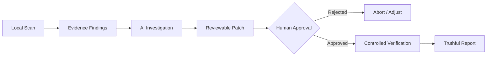

# RepoGuard 🛡️

> **CLI-first AI software reliability tool providing safe, evidence-backed repository inspection, AI-assisted investigation, reviewable repairs, and controlled verification.**

[](https://github.com/Pratham707-S/repoguard)
[](#architecture-principles)
[](https://www.typescriptlang.org/)
[](https://nodejs.org/)

---

## 🎯 Vision & Workflow

RepoGuard is engineered to give developers trustworthy, deterministic, and safe AI assistance directly from the terminal. Rather than blindly executing code or hallucinating fixes, RepoGuard strictly enforces a human-in-the-loop, evidence-driven workflow:



1. **Local Repository Scan:** Safe, read-only discovery of repository structure, ignoring binary files, sensitive paths, and oversized files.
2. **Evidence-Backed Findings:** High-signal static and architectural findings grounded with line numbers, code snippets, and deterministic metadata.
3. **AI Investigation:** Structured analysis conducted through provider-agnostic abstractions with automatic secret redaction and context trimming.
4. **Reviewable Repair Proposal:** Generation of exact unified diffs with path traversal validation; no files are modified without consent.
5. **Human Approval:** Explicit confirmation gate. The developer inspects the diff before anything touches disk.
6. **Controlled Verification:** Execution of policy-approved checks (lint, tests, build) inside strict timeout boundaries.
7. **Truthful Reporting:** Accurate outcome classification (`PASSED`, `FAILED`, `TIMED_OUT`, `SKIPPED`) with zero false assurances.

---

## 🧱 Architecture Principles

* **Modular Monolith:** Kept lean and cohesive within a single repository without premature microservices, cloud backends, message queues, or vector databases.
* **Strict Decoupling:** Core domain logic never depends directly on a specific terminal UI library, AI vendor SDK, or transport protocol.
* **Zero Accidental Leaks:** Secrets, environment tokens, and private configuration are redacted before preparing context payloads for AI providers.
* **No Uncontrolled Execution:** No arbitrary shell commands generated by models are ever run directly. Only allowlisted verification commands run within safe timeouts.

---

## 🗺️ MVP Milestones

| Milestone | Focus | Deliverables |
| :--- | :--- | :--- |
| **Milestone A** | CLI Foundation | CLI entry point, command routing, help output, exit codes, config validation |
| **Milestone B** | Safe Scanning | Root discovery, ignore rule parsing, binary/secret exclusion, metadata detection |
| **Milestone C** | Evidence Findings | Typed `Finding` schema, path and snippet verification, JSON and terminal output |
| **Milestone D** | AI Analysis | `AIProvider` contract, mock provider, structured response validation, secret redaction |
| **Milestone E** | Repair Proposals | Patch generation, path boundary validation, unified diff preview, human approval gate |
| **Milestone F** | Verification | Policy-approved check runner, timeout enforcement, truthful status report |

For long-term roadmap details, see [docs/ROADMAP.md](docs/ROADMAP.md).

---

## 👥 Team & Ownership

RepoGuard is developed collaboratively with strict modular monolith ownership:

* **Team Lead:** CLI interface & routing (`src/cli/`), application use cases (`src/application/`), shared domain schemas (`src/domain/`), AI analysis agents (`src/analysis/`), provider adapters (`src/providers/`), and utilities (`src/utils/`).
* **Pratham:** Repair proposal engine (`src/repair/`), verification runner & Docker sandboxing (`src/verification/`), and domain repair/verification contracts.
* **Ayan:** Configuration loader & schemas (`src/config/`), local state persistence (`src/storage/`), report generators (`src/report/`), and examples (`examples/`). *(CLI is owned by Team Lead).*
* **Manni:** Repository root discovery & file traversal (`src/repository/`), bounded context assembly & secret redaction (`src/context/`), and repository domain models.

See [docs/TEAM_TASKS.md](docs/TEAM_TASKS.md) for detailed task breakdowns and acceptance criteria.

---

## 🚀 Getting Started & Team Development

### 1. Clone the Repository
```bash
git clone https://github.com/Pratham707-S/repoguard.git
cd repoguard
```

### 2. Install Dependencies
```bash
# Node.js >= 22 required (see .nvmrc)
nvm use 22
npm install
```

### 3. Build & Verify
```bash
# Type check all source files, tests, and scripts
npm run typecheck

# Run test suite
npm test

# Build production bundle to dist/
npm run build
```

### 4. Working on an Assigned Module
All modules export their public API via clean `index.ts` barrel files, with path aliases mapped to `@repoguard/*`:
- `@repoguard/domain`: Domain contracts and entities
- `@repoguard/context`: Bounded context and secret redaction
- `@repoguard/repository`: File walking and discovery
- `@repoguard/analysis`: Rule engine and AI analysis orchestrator
- `@repoguard/providers`: LLM provider adapters
- `@repoguard/repair`: Patch parsing and proposal generation
- `@repoguard/verification`: Controlled subprocess check execution
- `@repoguard/config`: Configuration schema and loader
- `@repoguard/storage`: Local state and run persistence
- `@repoguard/report`: Markdown and JSON report builders

Always coordinate shared domain schemas in `src/domain/` with the team before introducing cross-module contract changes.

---

## 📚 Documentation Index

* 📐 [Architecture Specifications](docs/ARCHITECTURE.md)
* 🗺️ [Development Roadmap](docs/ROADMAP.md)
* 📋 [Team Tasks & Contracts](docs/TEAM_TASKS.md)
* 🛡️ [Security & Redaction Policy](SECURITY.md)
* 🤝 [Contributing Guidelines](CONTRIBUTING.md)

---

## 🔒 Safety & Responsible AI

RepoGuard operates strictly locally by default:
* Scans are read-only.
* Generated patches require interactive confirmation.
* Verification commands are limited to predefined project checks.
* For security disclosures and policies, please review [SECURITY.md](SECURITY.md).
