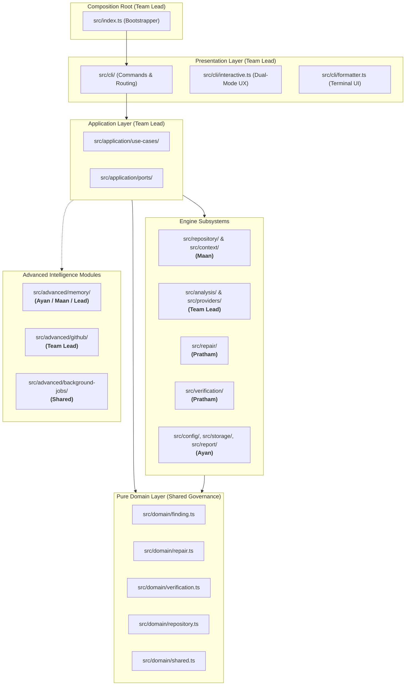

# RepoGuard Architecture Specification 📐

RepoGuard is structured as a **modular monolith** in TypeScript and Node.js. It enforces clean separation of concerns, strict boundary isolation, and zero coupling between core reliability use cases and presentation/transport layers. The architecture is aligned with our **final 11-feature scope**.

---

## 🏛️ High-Level Component Topology

---

## 🧩 Layer Responsibilities & Module Ownership

### 1. Presentation & CLI Layer (`src/cli/` — Owner: Team Lead)
* **`src/cli/commands/`:** Interprets CLI options (`--format`, `--timeout`, `--policy`, `--target`) using `commander`. Handles subcommands: `init`, `scan`, `report`, `status`, `review`.
* **`src/cli/interactive.ts`:** Dual-mode interactive launcher and animated terminal branding.
* **`src/cli/formatter.ts`:** Formats terminal tables, diff colors, and status indicators.
* **Exit Codes:** Strict UNIX exit code discipline (`0` for clean pass, `1` for actionable findings/failures, `2` for configuration/runtime errors).

### 2. Application Layer (`src/application/` — Owner: Team Lead)
* Orchestrates workflows independently of transport or UI:
  * `ScanRepositoryUseCase`, `ReviewFindingsUseCase`, `ProposeRepairUseCase`, `VerifyRepairUseCase`, `SearchRepairMemoryUseCase`.
* Defines decoupled inversion ports (`ports/`) for scanner, test runner, AI provider, memory store, and GitHub adapters.

### 3. Pure Domain Layer (`src/domain/` — Shared Governance)
* Zero external dependencies; houses canonical types, Zod schemas, and domain entities:
  * `finding.ts`: `Finding`, `FindingSeverity`, `FindingStatus`, `EvidenceReference`.
  * `repair.ts`: `RepairProposal`, `Patch`, `DiffPreview`.
  * `verification.ts`: `VerificationResult`, `CheckPolicy`, `ExecutionOutcome`.
  * `repository.ts`: `RepositoryMetadata`, `FileInfo`, ignore patterns.
  * `shared.ts`: Shared primitives, result wrappers, and timestamps.

### 4. Engine Subsystems
* **Repository Ingestion & Context (`src/repository/`, `src/context/` — Owner: Maan):**
  * Discovers repository root (`discovery.ts`), safely traverses directories respecting `.gitignore`, binary skips, and 1MB size threshold (`file-walker.ts`).
  * Extracts Git status, commit history, and line blame (`git-reader.ts`).
  * Redacts credentials, tokens, and secrets via entropy/regex (`secret-redactor.ts`) and bounds context tokens (`context-builder.ts`).
* **Analysis & Providers (`src/analysis/`, `src/providers/` — Owner: Team Lead):**
  * Evaluates deterministic security rules SEC-001 - SEC-004 (`rules/rule-runner.ts`, `suspicious-patterns.ts`).
  * Orchestrates multi-pass analysis agents (`bug-investigation`, `security-review`, `performance-review`).
  * Implements `AIProvider` contract via `GeminiAdapter` and `MockAdapter`.
  * Computes evidence-backed confidence metrics (`confidence.ts`).
* **Repair Engine (`src/repair/` — Owner: Pratham):**
  * Parses unified diffs (`patch-parser.ts`), enforces path traversal guards (`safe-path.ts`), and applies patches safely (`patch-applicator.ts`).
  * Enforces interactive human approval gate with diff preview before any disk modifications (`approval-gate.ts`, `diff-preview.ts`).
* **Controlled Verification (`src/verification/` — Owner: Pratham):**
  * Executes allowlisted commands (`test`, `lint`, `typecheck`) with wall-clock timeouts (`check-runner.ts`).
  * Classifies outcomes truthfully into `PASSED`, `FAILED`, `TIMED_OUT`, `SKIPPED` (`result-classifier.ts`).
  * Staged container sandbox runner (`sandbox/docker-runner.ts`, `resource-limits.ts`).
* **Configuration, Storage & Reporting (`src/config/`, `src/storage/`, `src/report/` — Owner: Ayan):**
  * Resolves and validates `repoguard.config.json` with safe defaults (`schema.ts`, `loader.ts`).
  * Persists scan runs and findings in local state directory `.repoguard/state` (`run-store.ts`, `state-store.ts`).
  * Formats comprehensive HTML, Markdown, and JSON audit reports (`markdown-report.ts`, `html-report.ts`, `json-report.ts`, `evidence-timeline.ts`).

### 5. Advanced Intelligence Modules (`src/advanced/`)
* **Memory & Feedback (`src/advanced/memory/` — Ayan / Maan / Lead):**
  * Persistent fix memory (`repair-memory.ts`, `memory.contract.ts`), fix outcome learning (`success-failure-feedback.ts`), and cross-repo immunization discovery (`cross-repo-search.ts`, `immunization-recommendations.ts`).
* **GitHub Integration (`src/advanced/github/` — Team Lead):**
  * Authorized GitHub App token management, permission checks, and automated pull request generation (`pull-request-publisher.ts`, `pull-request-builder.ts`).

---

## 🔒 Non-Negotiable Safety & Isolation Invariants

1. **Read-Only Invariant:** Repository scanning, static analysis, and AI investigation operate in strictly read-only mode.
2. **Mandatory Approval Invariant:** No proposed patch is ever applied to disk without explicit, interactive human confirmation.
3. **Execution Invariant:** Model responses are never piped to `eval` or executed as arbitrary shell scripts. Subprocess execution is restricted to allowlisted commands with timeouts.
4. **Redaction Invariant:** Context payloads must pass through the entropy/regex redaction filter prior to leaving the local machine.
5. **Path Traversal Invariant:** All patch targets and file walks are strictly validated against repository boundaries to block path traversal and symlink escapes.
