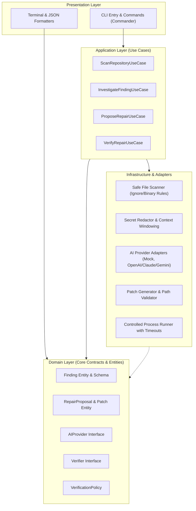

# RepoGuard Architecture Specification 📐

RepoGuard is structured as a **modular monolith** in TypeScript and Node.js. It enforces clean separation of concerns, strict boundary isolation, and zero coupling between core reliability use cases and presentation/transport layers.

---

## 🏛️ High-Level Component Topology

---

## 🧩 Layer Responsibilities & Boundaries

### 1. Presentation Layer (`src/cli/`)
* **Commands:** Interprets CLI options (`--format`, `--timeout`, `--policy`, `--target`).
* **Terminal UI:** Displays colored output, evidence tables, diff previews, and handles interactive confirmation (`[y/N]`).
* **Exit Codes:** Maps domain outcomes to standard UNIX exit codes (`0` for success, `1` for findings/failures, `2` for configuration/runtime errors).

### 2. Application Layer (`src/application/`)
* Orchestrates workflows without knowing whether the trigger was a CLI command, a script, or an API call.
* Coordinates between the file scanner, the redaction engine, the AI provider, and the verifier runner.

### 3. Domain Layer (`src/domain/`)
* Houses all pure TypeScript types, schemas (Zod), and domain entities.
* **Dependencies:** None. Has zero dependencies on file systems, network libraries, or external frameworks.
* Key models:
  - `Finding`: `{ id, title, severity, category, file, line, codeSnippet, evidence, timestamp }`
  - `RepairProposal`: `{ findingId, summary, rationale, patch: { filePath, diff, originalContent, proposedContent } }`
  - `VerificationResult`: `{ checkName, command, status: 'PASSED'|'FAILED'|'TIMED_OUT'|'SKIPPED', exitCode, stdout, stderr, durationMs }`

### 4. Infrastructure Layer (`src/infrastructure/`)
* **Safe Scanner:** Discovers the repository root, parses `.gitignore`, skips binary files and node modules, skips files exceeding configured size limits.
* **Secret Redactor:** Scans context buffers for secrets, tokens, and keys before payloads leave the local machine.
* **AI Provider Adapters:** Implements `AIProvider` contract (`analyzeFinding()`, `generateRepair()`). Features a `MockAIProvider` for test suites.
* **Patch Engine:** Formats unified diffs, validates that relative paths never escape the repo root, and performs safe, reversible file updates.
* **Controlled Verifier:** Spawns sub-processes for policy-allowed verification commands under strict wall-clock timeouts.

---

## 🔒 Safety and Isolation Invariants

1. **Read-Only Invariant:** Scanning and AI investigation never modify any file on disk.
2. **Approval Invariant:** No proposed patch is written to disk without interactive confirmation.
3. **Execution Invariant:** Model responses are never piped to `eval` or executed as arbitrary shell scripts.
4. **Redaction Invariant:** Context payloads must pass through the redaction filter prior to hitting network adapters.
