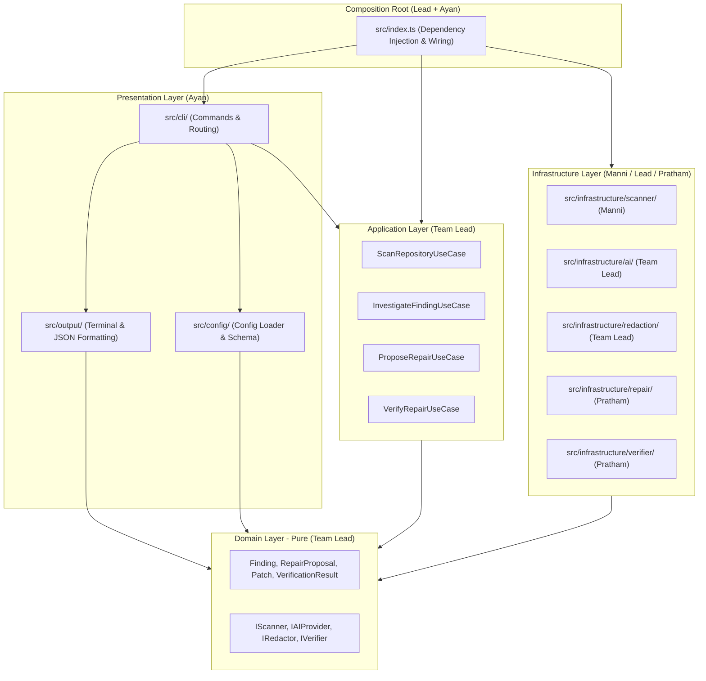

# RepoGuard Architecture Specification 📐

RepoGuard is structured as a **modular monolith** in TypeScript and Node.js. It enforces clean separation of concerns, strict boundary isolation, and zero coupling between core reliability use cases and presentation/transport layers.

---

## 🏛️ High-Level Component Topology

---

## 🧩 Layer Responsibilities & Boundaries

### 1. Presentation Layer (`src/cli/`, `src/config/`, `src/output/` — Ayan)
* **`src/cli/`:** Interprets CLI options (`--format`, `--timeout`, `--policy`, `--target`) using `commander`. Handles user prompts and routes calls to application use cases.
* **`src/config/`:** Resolves and validates configuration (`repoguard.config.json` and CLI flag overrides) against strict Zod schemas with fallback defaults.
* **`src/output/`:** Formats domain models into colored terminal tables, badges, and unified diff previews, or serializes clean JSON strings (`--format json`). **Never executes use cases or modifies disk.**
* **Exit Codes:** Maps domain outcomes to standard UNIX exit codes (`0` for success, `1` for findings/failures, `2` for configuration/runtime errors).

### 2. Application Layer (`src/application/` — Team Lead)
* Orchestrates workflows (`ScanRepositoryUseCase`, `InvestigateFindingUseCase`, etc.) without coupling to whether the trigger was CLI or a script.
* Coordinates between the file scanner, the redaction engine, the AI provider, and the verifier runner purely through domain interfaces.

### 3. Domain Layer (`src/domain/` — Team Lead)
* Houses all pure TypeScript types, schemas (Zod), and domain entities.
* **Dependencies:** None. Zero dependencies on file systems, network libraries, or external frameworks.
* Key models:
  - `Finding`: `{ id, title, severity, category, file, line, codeSnippet, evidence, timestamp }`
  - `RepairProposal`: `{ findingId, summary, rationale, patch: { filePath, diff, originalContent, proposedContent } }`
  - `VerificationResult`: `{ checkName, command, status: 'PASSED'|'FAILED'|'TIMED_OUT'|'SKIPPED', exitCode, stdout, stderr, durationMs }`

### 4. Infrastructure Layer (`src/infrastructure/`)
* **Safe Scanner (`src/infrastructure/scanner/` — Manni):** Discovers repository root, parses `.gitignore`, skips binary files, node_modules, and files > 1MB. Strictly read-only.
* **Secret Redactor (`src/infrastructure/redaction/` — Team Lead):** Scans context buffers for secrets, tokens, and keys before payloads leave the local machine.
* **AI Provider Adapters (`src/infrastructure/ai/` — Team Lead):** Implements `AIProvider` contract (`analyzeFinding()`, `generateRepair()`). Features a `MockAIProvider` for test suites.
* **Patch Engine (`src/infrastructure/repair/` — Pratham):** Formats unified diffs, validates that relative paths never escape the repo root, and manages interactive human approval (`[y/N]`).
* **Controlled Verifier (`src/infrastructure/verifier/` — Pratham):** Spawns sub-processes for policy-allowed verification commands under strict wall-clock timeouts.

---

## 🔒 Safety and Isolation Invariants

1. **Read-Only Invariant:** Scanning and AI investigation never modify any file on disk.
2. **Approval Invariant:** No proposed patch is written to disk without interactive human confirmation.
3. **Execution Invariant:** Model responses are never piped to `eval` or executed as arbitrary shell scripts.
4. **Redaction Invariant:** Context payloads must pass through the redaction filter prior to hitting network adapters.
5. **No Circular Dependencies:** Circular imports are strictly forbidden across all module boundaries.
