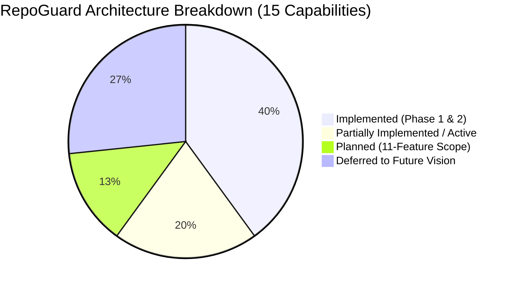

# RepoGuard Strategic Roadmap 🗺️

This document outlines the official development roadmap for **RepoGuard**, aligned with our **final 11-feature architecture scope**. It tracks delivered capabilities from Phase 1 & Phase 2 and defines the planned execution sequence for the remaining active features.

---

## 📊 Feature Status & Architecture Scope

| # | Capability | Current Status | Sprint | Primary Owner | Scope & Implementation Notes |
| :-: | :--- | :---: | :---: | :--- | :--- |
| **01** | **Repository / GitHub Ingestion** | **Implemented (Local)** / *Partial (Remote)* | Sprint 3 | Maan (Manni) | Local file walking, size limits, binary skip, `.gitignore` complete; remote shallow ingestion planned. |
| **02** | **Multi-Pass Investigation** | **Implemented (Static)** / *Partial (AI Agents)* | Sprint 2 | Team Lead | Deterministic security rule runner (SEC-001 - SEC-004) live; multi-pass AI investigation agents staged. |
| **03** | **RAG & Persistent Memory** | *Planned* | Sprint 3 | Ayan + Lead | Persistent retrieval of historical fixes & conventions into prompt context. |
| **04** | **AI Repair Engineer** | **Partial (Engine Ready)** | Sprint 1 | Pratham + Lead | Diff parser, patch applicator, and repair orchestrator live; Gemini patch synthesis hookup active. |
| **05** | **Sandbox Verification** | **Implemented (Subprocess)** / *Partial (Docker)* | Sprint 1 | Pratham | Bounded subprocess runner with allowlist & timeouts live; Docker sandbox runner finishing. |
| **06** | **Learn from Fix Outcomes** | *Planned* | Sprint 2 | Ayan + Pratham | Recording verified vs rejected repair patterns into empirical outcome dataset. |
| **07** | **Authorized GitHub Pull Requests** | *Planned* | Sprint 3 | Team Lead + Pratham | Least-privilege GitHub App token authentication and automated PR publication with audit evidence. |
| **08** | **Root-Cause Timeline** | **Implemented (Basic)** / *Partial (Blame)* | Sprint 2 | Ayan + Maan | Sequential run timeline live; Git blame commit lineage and historical correlation finishing. |
| **09** | **Evidence-Based Repair Confidence** | **Implemented (Static)** / *Partial (Dynamic)* | Sprint 1 | Team Lead + Pratham | Static rule confidence live; dynamic multi-factor calibration (verification + AST) finishing. |
| **10** | **Human Approval Gate** | **Implemented** | Phase 2 | Pratham | Non-negotiable confirmation gate with diff preview, affirmative prompts, and traversal blocking live. |
| **11** | **Cross-Repo Ripple Immunization** | *Planned* | Sprint 3 | Maan + Team Lead | Pattern matching resolved vulnerabilities in Repo A to recommend patches across Repos B & C. |

---

## 🎯 Completed Foundations (Phase 1 & Phase 2)

The core vertical slice and safety invariants are fully implemented, verified, and passing test suites:

### Phase 1 — Ingestion, Static Rules, Storage & Reporting (Completed ✅)
* **Safe Repository Ingestion:** Read-only traversal, `.gitignore` parser, 1MB file limit, binary detection (`src/repository/`).
* **Context & Secret Redaction:** Bounded context builder and entropy/regex secret scrubber replacing keys with `[REDACTED_SECRET]` (`src/context/`).
* **Deterministic Security Rules:** Static AST and regex rule runner evaluating OWASP security patterns SEC-001 through SEC-004 (`src/analysis/rules/`).
* **Configuration & Storage:** Zod-validated configuration loader (`src/config/`) and local run/state persistence (`src/storage/`).
* **Multi-Format Reporting:** Comprehensive HTML, Markdown, and JSON audit report generators with evidence summaries (`src/report/`).
* **Interactive CLI:** Interactive terminal launcher with dual modes, animated branding, and UNIX-compliant exit codes (`src/cli/`).

### Phase 2 — Safe Repair & Verification Foundation (Completed ✅)
* **Unified Diff Engine:** Standard unified diff parser and patch applicator (`src/repair/`).
* **Path Traversal Security:** Cross-platform path validation blocking directory escape and symlink traversal (`src/utils/safe-path.ts`).
* **Interactive Approval Gate:** Mandatory developer confirmation gate before writing any patch to disk (`src/repair/approval-gate.ts`).
* **Terminal Diff Preview:** Colored unified diff visualizer with numbered hunks (`src/repair/diff-preview.ts`).
* **Allowlisted Check Runner:** Subprocess runner executing allowlisted commands with strict wall-clock timeouts and truthful outcome classification (`src/verification/`).

---

## 🚀 Active Roadmap: Implementation Sprints (Remaining Work)

### Sprint 1 — Core Automation Loop (Immediate Priority)
* **Milestone 1.1: AI Patch Synthesis Pipeline (Feature 4)**
  * Connect `GeminiAdapter.generateRepair()` to `RepairOrchestrator`.
  * Validate model output against unified diff schemas with fallback retries.
* **Milestone 1.2: Dynamic Confidence Calibration (Feature 9)**
  * Wire verification check outcomes into `src/analysis/confidence.ts` (+30% boost for clean test runs, penalty for failures).
* **Milestone 1.3: Docker Container Sandbox (Feature 5)**
  * Complete `src/verification/sandbox/docker-runner.ts` and `resource-limits.ts` for containerized test runs.

### Sprint 2 — Audit Intelligence & Memory
* **Milestone 2.1: Root-Cause Timeline with Git Blame (Feature 8)**
  * Extract commit author, SHA, and timestamps via `src/repository/git-reader.ts` to enrich `evidence-timeline.ts`.
* **Milestone 2.2: Multi-Pass AI Investigation (Feature 2)**
  * Activate specialized agents (`bug-investigation.agent.ts`, `security-review.agent.ts`, `performance-review.agent.ts`).
* **Milestone 2.3: Fix Outcome Feedback Store (Feature 6)**
  * Implement `src/advanced/memory/success-failure-feedback.ts` to log verified vs rejected patches.

### Sprint 3 — Enterprise Integration & Scale
* **Milestone 3.1: Authorized GitHub Pull Requests (Feature 7)**
  * Implement `src/advanced/github/pull-request-publisher.ts` with GitHub App token authentication and rich PR markdown bodies.
* **Milestone 3.2: RAG Persistent Memory (Feature 3)**
  * Implement local index retrieval in `src/advanced/memory/repair-memory.ts` for contextual repair guidance.
* **Milestone 3.3: Cross-Repository Immunization (Feature 11)**
  * Enable multi-repo directory matching in `src/advanced/memory/cross-repo-search.ts` to suggest preventative patches across sister repositories.

---

## 🔮 Deferred Future Capabilities Roadmap (Post-11 Features)

The following four capabilities were originally proposed in the 15-feature vision but are **strictly deferred from the current architecture scope** to ensure focus on shipping a rock-solid, verifiable 11-feature product:

1. **Regression & Side-Effect Prediction:** Deep downstream blast-radius analysis across dependency graphs.
2. **Repository Knowledge Graph:** Global AST-level call trees and symbol dependency graphs.
3. **Future Bug Predictor:** Statistical hotspot defect prediction correlated with code churn and complexity.
4. **Telemetry-Driven Rollback:** Production telemetry ingestion triggering automated revert PRs.
