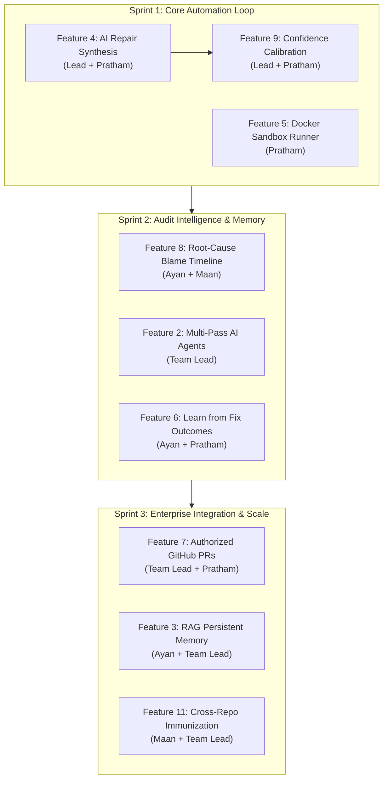

# RepoGuard Team Tasks & Ownership Matrix 👥

Updated for the **Final 11-Feature Architecture** following Phase 1 & Phase 2 delivery. This document serves as the authoritative source of truth for module ownership, shared contracts, completed milestones, and remaining implementation deliverables across the engineering team.

---

## 🏛️ Team Roster & Focus Areas

| Member | Focus Area | Owned Code Modules | Core Responsibilities |
| :--- | :--- | :--- | :--- |
| **Team Lead** *(me)* | Architecture, CLI, AI Analysis & GitHub Integration | `src/cli/` `src/application/` `src/domain/` `src/analysis/` `src/providers/` `src/advanced/github/` `src/utils/` | System architecture, CLI command routing & interactive UX (`commander`), domain entity schemas (`Zod`), multi-pass analysis agents & rule engine, AI model adapters (`Gemini`), evidence confidence scoring, authorized GitHub PR publisher, composition root (`src/index.ts`). |
| **Pratham** | Repair Engine & Sandbox Verification | `src/repair/` `src/verification/` `src/domain/repair.ts` `src/domain/verification.ts` | Unified diff parsing & application, path traversal security enforcement, interactive human approval prompt gate, subprocess check execution with wall-clock timeouts, Docker container sandbox adapter. |
| **Ayan** | Configuration, Storage, Reports & Memory | `src/config/` `src/storage/` `src/report/` `src/advanced/memory/` `examples/` `.repoguard/` | Configuration schema & loading (`repoguard.config.json`), local state & run store persistence (`.repoguard/state`), HTML, Markdown & JSON audit reporting, evidence timeline visualization, fix outcome feedback memory store. |
| **Maan (Manni)** | Repository Ingestion, Context & Cross-Repo | `src/repository/` `src/context/` `src/domain/repository.ts` | Repository root detection, safe file traversal (`.gitignore`, limits, binary skips), Git status & historical commit/blame extraction, bounded context assembly, high-entropy regex secret redaction, multi-repo immunization discovery. |

---

## 🎯 Final 11-Feature Scope vs Deferred Features

### The 11 Active Features
1. **Repository / GitHub Ingestion:** Safe local traversal + Git remote diff/repo ingestion.
2. **Multi-Pass Investigation:** Deterministic AST rules + AI specialized analysis agents.
3. **RAG & Persistent Memory:** Bounded retrieval of historical fixes & conventions into prompt context.
4. **AI Repair Engineer:** AI patch synthesis bound to findings + unified diff generation.
5. **Sandbox Verification:** Subprocess runner + Docker sandbox isolation with strict timeouts.
6. **Learn from Fix Outcomes:** Historical record of verified vs rejected repair attempts.
7. **Authorized GitHub Pull Requests:** Least-privilege automated PR creation with verification badges.
8. **Root-Cause Timeline:** Chronological timeline linking Git commits, findings, and diffs.
9. **Evidence-Based Repair Confidence:** Multi-factor confidence scoring derived from AST & test outcomes.
10. **Human Approval Gate:** Mandatory interactive confirmation before applying any disk changes.
11. **Cross-Repo Ripple Immunization:** Proactive pattern matching & patch recommendations across connected repositories.

### Deferred Features (Strictly Out of Current Scope)
* 🚫 **Regression & Side-Effect Prediction:** Deep downstream blast-radius analysis (Deferred to later research).
* 🚫 **Repository Knowledge Graph:** Full codebase AST-level call/import graph (Deferred).
* 🚫 **Future Bug Predictor:** Churn & statistical hotspot defect prediction (Deferred).
* 🚫 **Telemetry-Driven Rollback:** Production telemetry ingestion & automated revert PRs (Deferred).

---

## 📋 Teammate Ownership, Delivered Work & Remaining Deliverables

### 1. Team Lead
* **Primary Role:** Architecture, CLI Routing, AI Analysis, Domain Contracts, System Integration
* **Owned Directories:** `src/cli/`, `src/application/`, `src/domain/`, `src/analysis/`, `src/providers/`, `src/advanced/github/`, `src/utils/`

#### ✅ Delivered in Phase 1 & 2 (Completed — Do Not Re-implement)
* **Domain Schemas:** Canonical schemas and contracts (`finding.ts`, `shared.ts`).
* **Static Rule Engine:** Deterministic rule runner (`rules/rule-runner.ts`, `rules/suspicious-patterns.ts` for SEC-001 - SEC-004).
* **CLI Framework:** Command definitions (`init`, `scan`, `report`, `status`, `review`), interactive terminal launcher, animated branding, formatting utilities.
* **Provider Adapters:** `MockAdapter` and `GeminiAdapter` foundational communication stubs.
* **Baseline Confidence Scoring:** Initial static confidence metric calculation (`analysis/confidence.ts`).

#### 🚀 Remaining Deliverables (11-Feature Roadmap)
1. **Multi-Pass Investigation (Feature 2):** Connect specialized agents (`bug-investigation.agent.ts`, `security-review.agent.ts`, `performance-review.agent.ts`) to `GeminiAdapter` for deep multi-pass reasoning.
2. **AI Repair Synthesis (Feature 4 Co-ownership):** Implement structured LLM prompts in `GeminiAdapter` to generate valid unified diffs from findings.
3. **Dynamic Confidence Calibration (Feature 9):** Enhance `confidence.ts` to compute dynamic post-verification confidence scores combining static evidence + verification results.
4. **Authorized GitHub PR Publisher (Feature 7):** Implement `src/advanced/github/pull-request-publisher.ts` with GitHub App authentication, branch generation, and commit creation.

#### Integration Contracts & Dependencies
* Exposes `IAIProvider` and `Finding` contracts to Pratham's `RepairOrchestrator`.
* Consumes Pratham's verification outcomes to calibrate the final confidence score.
* Exposes CLI commands routing into Ayan's configuration loader and report generators.

---

### 2. Pratham
* **Primary Role:** Repair Engine, Human Approval Gate, Sandbox Verification
* **Owned Directories:** `src/repair/`, `src/verification/`, `src/domain/repair.ts`, `src/domain/verification.ts`

#### ✅ Delivered in Phase 1 & 2 (Completed — Do Not Re-implement)
* **Unified Diff Parser (`patch-parser.ts`):** Robust parser for unified diffs with chunk validation and path normalization.
* **Path Traversal Security:** Mandatory guards preventing directory traversal escapes (`safe-path.ts`) across all platforms.
* **Diff Preview (`diff-preview.ts`):** Terminal-colored unified diff visualizer with hunk numbering.
* **Human Approval Gate (`approval-gate.ts`):** Interactive confirmation gate with affirmative prompt, non-interactive bypass protection, and explicit user controls.
* **Patch Applicator (`patch-applicator.ts`):** Atomic patch application to local disk with external symlink security validation.
* **Verification Check Runner (`check-runner.ts`):** Subprocess runner executing allowlisted commands (`test`, `lint`, `typecheck`) with wall-clock timeout protection and truthful outcome classification (`result-classifier.ts`).

#### 🚀 Remaining Deliverables (11-Feature Roadmap)
1. **Repair Orchestrator Wiring (Feature 4):** Connect `repair-orchestrator.ts` to the AI provider response to generate, parse, preview, and apply candidate fixes end-to-end.
2. **Docker Sandbox Adapter (Feature 5):** Complete `src/verification/sandbox/docker-runner.ts` and `resource-limits.ts` to allow running untrusted test suites in disposable Docker containers.
3. **Verification Outcome Event Emitter (Feature 6 Co-ownership):** Emit structured `{ findingId, patch, verificationResult }` payloads to Ayan's feedback store.
4. **PR Patch Payload Formatter (Feature 7 Co-ownership):** Format approved candidate patches and verification proof summary for GitHub PR body.

#### Integration Contracts & Dependencies
* Receives findings from Team Lead's analysis engine.
* Hands off verification outcomes to Team Lead's confidence engine and Ayan's feedback store.
* Relies on Maan's repo root path and git status to ensure working trees remain clean.

---

### 3. Ayan
* **Primary Role:** Configuration, Storage, Audit Reporting, Fix Memory
* **Owned Directories:** `src/config/`, `src/storage/`, `src/report/`, `src/advanced/memory/`, `examples/`, `.repoguard/`

#### ✅ Delivered in Phase 1 & 2 (Completed — Do Not Re-implement)
* **Configuration Loader & Schema:** `src/config/schema.ts` and `src/config/loader.ts` with CLI flag overrides and safe fallback defaults.
* **Run & State Store:** `src/storage/run-store.ts` and `src/storage/state-store.ts` for persisting scan histories and finding states in `.repoguard/`.
* **Multi-Format Report Builders:** `src/report/report-builder.ts`, `markdown-report.ts`, `html-report.ts`, and `json-report.ts` generating comprehensive audit reports.
* **Baseline Evidence Timeline:** `src/report/evidence-timeline.ts` formatting sequential run events.

#### 🚀 Remaining Deliverables (11-Feature Roadmap)
1. **Root-Cause Timeline Enhancement (Feature 8):** Enhance `evidence-timeline.ts` with Git blame and commit metadata (from Maan's `git-reader.ts`) to display chronological defect origins in HTML/Markdown reports.
2. **Learn from Fix Outcomes Store (Feature 6):** Implement `src/advanced/memory/success-failure-feedback.ts` to log verified fixes vs rejected patches, creating empirical repair datasets.
3. **RAG Persistent Memory Store (Feature 3):** Implement local storage index in `src/advanced/memory/repair-memory.ts` and query contract in `memory.contract.ts` to index and retrieve relevant fix patterns.

#### Integration Contracts & Dependencies
* Provides config resolution for all commands run by Team Lead.
* Receives verification results from Pratham to store in run history and feedback logs.
* Receives commit history and file blame from Maan for timeline enrichment.

---

### 4. Maan (Manni)
* **Primary Role:** Repository Discovery, Traversal, Context Intelligence, Cross-Repo Scanning
* **Owned Directories:** `src/repository/`, `src/context/`, `src/domain/repository.ts`

#### ✅ Delivered in Phase 1 & 2 (Completed — Do Not Re-implement)
* **Repository Root Discovery:** `src/repository/discovery.ts` detecting `.git` markers, project root, and package manager tooling.
* **Safe File Walker:** `src/repository/file-walker.ts` honoring `.gitignore`, default exclusions (`node_modules`, `.git`, `dist`), binary file skips, and the 1MB file size limit.
* **Git Reader:** `src/repository/git-reader.ts` extracting HEAD commit, branch status, and staged diffs.
* **Secret Redaction Filter:** `src/context/secret-redactor.ts` sanitizing API keys, passwords, high-entropy tokens, and `.env` credentials with `[REDACTED_SECRET]`.
* **Context Buffer Builder:** `src/context/context-builder.ts` assembling bounded file context windows.

#### 🚀 Remaining Deliverables (11-Feature Roadmap)
1. **Git Blame & History Extraction (Feature 8 Co-ownership):** Extend `git-reader.ts` to retrieve line-level commit blame and timestamps for detected vulnerabilities, feeding Ayan's root-cause timeline.
2. **Remote / GitHub Ingestion Support (Feature 1 Co-ownership):** Support ingesting remote repository diffs and shallow clones alongside local directories.
3. **Cross-Repo Scanner & Discovery (Feature 11):** Implement multi-repo file matching in `src/advanced/memory/cross-repo-search.ts` to identify identical vulnerable code patterns across connected sister repositories.

#### Integration Contracts & Dependencies
* Supplies safe file lists and sanitized context buffers to Team Lead's analysis orchestrator.
* Feeds Git blame metadata to Ayan's evidence timeline builder.
* Exposes multi-repo scanning primitives for cross-repo immunization.

---

## 🚀 Practical Implementation Order (Sprints 1 - 3)

1. **Sprint 1 — Core Automation Loop (Immediate Priority):**
   * Connect `GeminiAdapter.generateRepair()` to Pratham's `RepairOrchestrator` to produce real unified diffs from scan findings.
   * Calibrate confidence scores using actual test execution outcomes.
   * Complete Docker container sandbox fallback for environments requiring container isolation.
2. **Sprint 2 — Audit Intelligence & Memory:**
   * Enrich root-cause timelines with Git blame history to show exactly when and by whom defects were introduced.
   * Activate specialized multi-pass analysis agents for security, performance, and bug investigation.
   * Persist repair outcomes to build an empirical dataset of successful vs failed fixes.
3. **Sprint 3 — Enterprise Integration & Scale:**
   * Implement automated pull request publication via GitHub Apps with verified audit badges.
   * Enable persistent RAG memory retrieval of historical patch patterns into context buffers.
   * Implement cross-repository pattern scanning to proactively immunize connected repositories.

---

## 🔒 Collaboration & Code Governance Protocol

1. **Modular Boundary Invariant:** No direct cross-module coupling. Communication between subsystems must flow through `src/domain/` interfaces or `src/application/` ports.
2. **Zero In-Place Main Pushing:** All work must proceed via feature branches (`feature/<subsystem>/<feature-name>`), peer-reviewed PRs, and green CI runs.
3. **Test-First Verification:** Every new module deliverable must arrive with dedicated unit tests in `tests/unit/` and pass lint and typecheck prior to merge.
4. **Human In-The-Loop Safety:** Under no circumstances may automatic disk writes or arbitrary shell execution bypass the human approval gate or command allowlists.
