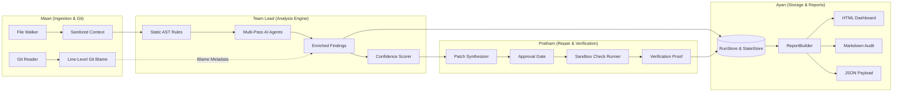

# RepoGuard Intelligence & Storage Contract Specifications 📝

This document provides architectural contract notes and data flow documentation explaining how **Intelligence outputs** (multi-pass agents, Git blame, repair synthesis, verification proofs) map cleanly into **RepoGuard's Report & Storage contracts** (`src/storage/`, `src/report/`).

---

## 🔄 End-to-End Intelligence Data Flow

---

## 📦 Canonical Contract Definitions

### 1. `StorageFinding` Schema (`src/storage/run-store.ts`)
The unified finding contract preserves baseline Phase 1/2 fields while accommodating intelligence metadata from Team Lead, Maan, and Pratham without breaking serialization.

| Field | Type | Description | Source |
| :--- | :--- | :--- | :--- |
| `id` | `string` | Unique finding identifier (e.g., `SEC-001-src-app.js-L14`). | Rule Runner / Lead |
| `category` | `string` | Human-readable category (e.g., `Security / Hardcoded Secrets`). | Rule Runner / Lead |
| `severity` | `'CRITICAL' \| 'HIGH' \| 'MEDIUM' \| 'LOW' \| 'INFO'` | Standard severity enum. | Rule Runner / Lead |
| `title` | `string` | Finding title. | Rule Runner / Lead |
| `path` | `string` | Relative file path normalized with forward slashes. | File Walker / Maan |
| `lineRange` | `{ start: number; end: number }` | 1-based start and end line coordinates. | AST Rule Runner |
| `explanation` | `string` | Clear description of the vulnerability or flaw. | Rule Runner / AI Agent |
| `evidence` | `string` (optional) | Code snippet showing defect (always redacted before reporting). | Ingestion / Rule Runner |
| `confidence` | `number` (optional) | Normalized 0.0–1.0 confidence score. | Confidence Scorer / Lead |
| `status` | `string` (optional) | Lifecycle status (`UNRESOLVED`, `RESOLVED`, `IGNORED`). | StateStore / Ayan |
| `recommendation` | `string` (optional) | Remediation guidance. | Rule / AI Agent |
| `cwe` | `string` (optional) | Standard CWE taxonomy identifier (e.g., `CWE-798`, `CWE-89`). | Rule / Security Agent |
| `ruleId` | `string` (optional) | Base rule identifier (e.g., `SEC-001`). | Rule Runner |
| `source` | `string` (optional) | Origin classifier (`static-ast`, `ai-agent`, etc.). | Analysis Engine |
| `agentName` | `string` (optional) | Name of specialized agent (`SecurityReviewAgent`, etc.). | AI Agent Pipeline |
| `blame` | `GitBlameMetadata` (optional) | Line-level Git blame metadata (`commitSha`, `author`, `date`). | Git Reader / Maan |
| `commitSha` | `string` (optional) | Direct commit hash if full blame is not attached. | Git Reader / Maan |
| `patch` | `string` (optional) | Synthesized unified diff patch. | Repair Engineer / Pratham |
| `suggestedFix` | `string` (optional) | High-level or inline fix snippet. | AI Agent / Lead |
| `verification` | `VerificationOutcome` (optional) | Empirical test result (`verified`, `command`, `exitCode`). | Check Runner / Pratham |
| `fingerprint` | `string` (optional) | Stable cross-scan hash for tracking shifted line numbers. | Scanner / Ayan |

### 2. `TimelineEventRecord` / `TimelineEvent`
Represents chronological steps in the audit or root-cause defect origin:
- `timestamp?: string` — ISO or relative time.
- `step?: string` — Pipeline or commit step label.
- `detail?: string` — Execution or commit details.
- `status?: 'INFO' \| 'SUCCESS' \| 'WARNING' \| 'ERROR'` — Status indicator.
- `durationMs?: number` — Step duration in milliseconds.
- `commitSha?: string` — Associated commit hash.
- `author?: string` — Associated commit author.
- `commitDate?: string` — Commit timestamp.
- `filePath?: string` — Associated file path.
- `line?: number` — Associated line number.

---

## 🛡️ Compatibility & Security Guarantees

1. **Zero Secret Leakage Invariant:**
   Both `evidence` and `patch` fields are automatically passed through `redactSecretEvidence()` in `src/report/redaction.ts` prior to inclusion in HTML, Markdown, and JSON outputs.
2. **Backward Compatibility:**
   Legacy scan records lacking intelligence fields (CWE, blame, verification, patches) render flawlessly without `undefined` strings or runtime exceptions.
3. **Forward Compatibility:**
   All new intelligence fields are marked optional (`?`). As Team Lead, Pratham, and Maan deliver their active sprint features, their outputs slot directly into these contracts without requiring additional storage migrations.
4. **Deterministic Cross-Run Tracking:**
   `computeFindingIdentifier()` prioritizes `finding.fingerprint`, followed by `finding.id`, and finally a composite key (`path:lines:category:title`), ensuring findings can be tracked accurately across runs even when line numbers shift.
