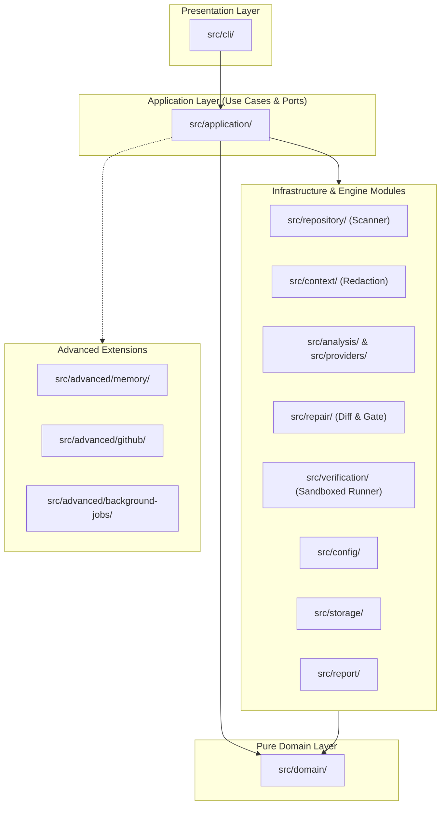

# RepoGuard — Project Structure & Architecture Summary

## 1. Executive Overview

**RepoGuard** is a CLI-first AI software reliability and security platform written in **TypeScript (Node.js >= 22, ESM)**. It implements an evidence-driven, human-in-the-loop workflow designed to safely scan repositories, investigate findings via AI, generate reviewable patches, and run policy-controlled verification without blind shell execution or unreviewed disk modifications.

---

## 2. Top-Level Directory Layout

| Directory / File | Description |
| :--- | :--- |
| [`src/`](file:///d:/repoguard/src) | Main TypeScript source code organized as a modular monolith with decoupled boundaries. |
| [`tests/`](file:///d:/repoguard/tests) | Comprehensive test suites partitioned into `unit`, `integration`, `security`, `e2e`, `fixtures`, and `helpers`. |
| [`docs/`](file:///d:/repoguard/docs) | Complete project documentation including architecture specs, ADRs, runbooks, threat models, and team task breakdowns. |
| [`examples/`](file:///d:/repoguard/examples) | Sample configurations (`repoguard.config.example.json`), mock findings, and sample markdown reports. |
| [`scripts/`](file:///d:/repoguard/scripts) | Build, cleanup, environment verification, and CLI packaging automation. |
| [`benchmarks/`](file:///d:/repoguard/benchmarks) | Benchmark runner, datasets, and evaluation harnesses for measuring finding quality. |
| [`.repoguard/`](file:///d:/repoguard/.repoguard) | Local state directory storing configuration, run histories, caches, and generated reports. |
| [`.github/`](file:///d:/repoguard/.github) | GitHub Actions workflows (CI, lint, test, release) and issue/PR templates. |
| [`package.json`](file:///d:/repoguard/package.json) | Package manifest and dependencies (`commander`, `zod`, `chalk`, `dotenv`). |
| [`tsconfig.json`](file:///d:/repoguard/tsconfig.json) | TypeScript configuration with `@repoguard/*` path aliases. |
| [`vitest.config.ts`](file:///d:/repoguard/vitest.config.ts) | Vitest test runner configuration with alias resolution and v8 coverage. |
| [`AGENTS.md`](file:///d:/repoguard/AGENTS.md) / [`GEMINI.md`](file:///d:/repoguard/GEMINI.md) | Architectural constraints, ownership rules, and assistant operating boundaries. |

---

## 3. Core Source Architecture (`src/`)

The application is structured into clearly separated layers adhering to Clean Architecture and Ports & Adapters:

### 3.1. Composition Root & Presentation
- **[`src/index.ts`](file:///d:/repoguard/src/index.ts)**: Composition root and application bootstrap.
- **[`src/cli/`](file:///d:/repoguard/src/cli)** *(Owner: Team Lead)*:
  - Command definitions (`scan`, `findings`, `review`, `fix`, `test`, `status`, `config`, `init`).
  - Terminal formatting, option parsing, and CLI entry routing (`cli.ts`, `formatter.ts`, `options.ts`).

### 3.2. Application Layer (`src/application/`) *(Owner: Team Lead)*
- Orchestrates workflows independently of transport or UI:
  - **Use Cases:** [`scan-repository.use-case.ts`](file:///d:/repoguard/src/application/use-cases/scan-repository.use-case.ts), [`review-findings.use-case.ts`](file:///d:/repoguard/src/application/use-cases/review-findings.use-case.ts), [`propose-repair.use-case.ts`](file:///d:/repoguard/src/application/use-cases/propose-repair.use-case.ts), [`verify-repair.use-case.ts`](file:///d:/repoguard/src/application/use-cases/verify-repair.use-case.ts), [`get-findings.use-case.ts`](file:///d:/repoguard/src/application/use-cases/get-findings.use-case.ts), [`initialize-project.use-case.ts`](file:///d:/repoguard/src/application/use-cases/initialize-project.use-case.ts), [`search-repair-memory.use-case.ts`](file:///d:/repoguard/src/application/use-cases/search-repair-memory.use-case.ts).
  - **Inversion Ports:** Decoupled interfaces for scanner, test runner, AI provider, memory store, patch writer, and GitHub adapters (`ports/`).
  - **DI Container:** [`container.ts`](file:///d:/repoguard/src/application/container.ts) and [`app.ts`](file:///d:/repoguard/src/application/app.ts).

### 3.3. Pure Domain Layer (`src/domain/`) *(Shared Governance)*
- Zero external dependencies; defines canonical schemas (Zod) and contracts:
  - [`finding.ts`](file:///d:/repoguard/src/domain/finding.ts): `Finding`, `FindingSeverity`, `FindingStatus`, `EvidenceReference`.
  - [`repair.ts`](file:///d:/repoguard/src/domain/repair.ts): `RepairProposal`, `Patch`, `DiffPreview`.
  - [`verification.ts`](file:///d:/repoguard/src/domain/verification.ts): `VerificationResult`, `CheckPolicy`, `ExecutionOutcome`.
  - [`repository.ts`](file:///d:/repoguard/src/domain/repository.ts): `RepositoryMetadata`, `FileInfo`, ignore patterns.
  - [`shared.ts`](file:///d:/repoguard/src/domain/shared.ts): Shared primitives, result wrappers, and timestamps.

### 3.4. Functional Subsystems & Infrastructure
- **[`src/repository/`](file:///d:/repoguard/src/repository)** *(Owner: Manni)*:
  - Repository root detection (`discovery.ts`), safe recursive directory walker (`file-walker.ts`), git reader (`git-reader.ts`), and metadata extraction (`metadata.ts`).
- **[`src/context/`](file:///d:/repoguard/src/context)** *(Owner: Manni)*:
  - Assembles bounded context buffers (`context-builder.ts`) and performs entropy/regex secret redaction (`secret-redactor.ts`).
- **[`src/analysis/`](file:///d:/repoguard/src/analysis)** & **[`src/providers/`](file:///d:/repoguard/src/providers)** *(Owner: Team Lead)*:
  - Rule execution engine (`rules/rule-runner.ts`, `suspicious-patterns.ts`), confidence scoring (`confidence.ts`), analysis orchestrator (`orchestrator.ts`).
  - Specialized AI agents: `bug-investigation`, `performance-review`, `security-review`.
  - LLM provider adapters: Gemini API adapter (`gemini-adapter.ts`) and deterministic mock adapter (`mock-adapter.ts`).
- **[`src/repair/`](file:///d:/repoguard/src/repair)** *(Owner: Pratham)*:
  - Repair orchestrator (`repair-orchestrator.ts`), unified diff parsing (`patch-parser.ts`), patch applicator (`patch-applicator.ts`), terminal diff preview (`diff-preview.ts`), and interactive user approval prompt gate (`approval-gate.ts`).
- **[`src/verification/`](file:///d:/repoguard/src/verification)** *(Owner: Pratham)*:
  - Subprocess check runner (`check-runner.ts`), timeout-protected execution, result classifier (`result-classifier.ts`), and optional Docker sandbox execution (`sandbox/docker-runner.ts`, `resource-limits.ts`).
- **[`src/config/`](file:///d:/repoguard/src/config)** *(Owner: Ayan)*:
  - Zod config schema definition (`schema.ts`) and multi-source loader (`loader.ts`).
- **[`src/storage/`](file:///d:/repoguard/src/storage)** *(Owner: Ayan)*:
  - Local SQLite / file persistence for runs (`run-store.ts`) and repository analysis state (`state-store.ts`).
- **[`src/report/`](file:///d:/repoguard/src/report)** *(Owner: Ayan)*:
  - Formatters for terminal tables, Markdown reports (`markdown-report.ts`), JSON export (`json-report.ts`), and evidence timelines (`evidence-timeline.ts`).
- **[`src/utils/`](file:///d:/repoguard/src/utils)** *(Owner: Team Lead)*:
  - Cross-cutting utilities: safe path resolution avoiding directory traversal (`safe-path.ts`), async helpers (`async.ts`), structured logging (`logger.ts`), and deterministic clocks (`clock.ts`).
- **[`src/advanced/`](file:///d:/repoguard/src/advanced)** *(Post-MVP Extensions)*:
  - Cross-repo memory and immunization (`memory/`), background workers (`background-jobs/`), and automated GitHub PR integration (`github/`).

---

## 4. Test Suite Structure (`tests/`)

The testing architecture mirrors the application boundaries to validate contracts and safety invariants:
- **`tests/unit/`**: Isolated unit tests for domain entities, rule runners, patch parsers, and redactors.
- **`tests/integration/`**: Verification of pipeline connections (`scan-pipeline`, `repair-verification`, `config-loading`, `provider-contract`).
- **`tests/security/`**: Invariant validation:
  - `path-traversal.test.ts`: Prevents diffs and scanners from traversing outside repository boundaries.
  - `secret-redaction.test.ts`: Asserts zero API keys/credentials leak into context payloads.
  - `unsafe-command-blocking.test.ts`: Asserts only allowlisted commands run with timeouts.
- **`tests/e2e/`**: CLI end-to-end command tests (`scan`, `review`, `init`).
- **`tests/helpers/` & `tests/fixtures/`**: Test repositories (`buggy-repo`, `clean-repo`, `vulnerable-repo`, `monorepo`) and mocked test harnesses.

---

## 5. Team Ownership Matrix

| Member | Primary Responsibility | Directory Scopes |
| :--- | :--- | :--- |
| **Team Lead** | Architecture, CLI routing, application use cases, domain contracts, AI analysis & providers, shared utilities | `src/cli/`, `src/application/`, `src/domain/`, `src/analysis/`, `src/providers/`, `src/utils/` |
| **Pratham** | Repair generation, diff preview, approval gates, verification execution & Docker sandboxing | `src/repair/`, `src/verification/`, `src/domain/repair/`, `src/domain/verification/` |
| **Ayan** | Configuration schemas & loading, local run storage, report generators, configuration examples | `src/config/`, `src/storage/`, `src/report/`, `examples/` *(CLI is owned by Team Lead)* |
| **Manni** | Repository discovery, file walking, ignore policies, bounded context, secret redaction | `src/repository/`, `src/context/`, `src/domain/repository/` |

---

## 6. Safety & Operating Invariants

1. **Read-Only Scans:** Scanning and file traversal strictly observe read-only guarantees; binary files and ignored paths are excluded.
2. **Interactive Confirmation Gate:** No patch or repair proposal touches disk without explicit interactive developer confirmation (`approval-gate.ts`).
3. **Strict Shell Allowlist:** Verification commands execute solely via predefined allowlists with hard timeout limits; arbitrary model-generated commands are never piped to execution.
4. **Zero Secret Leaks:** Every context buffer passes through entropy and pattern redactors prior to reaching any external or AI provider.
